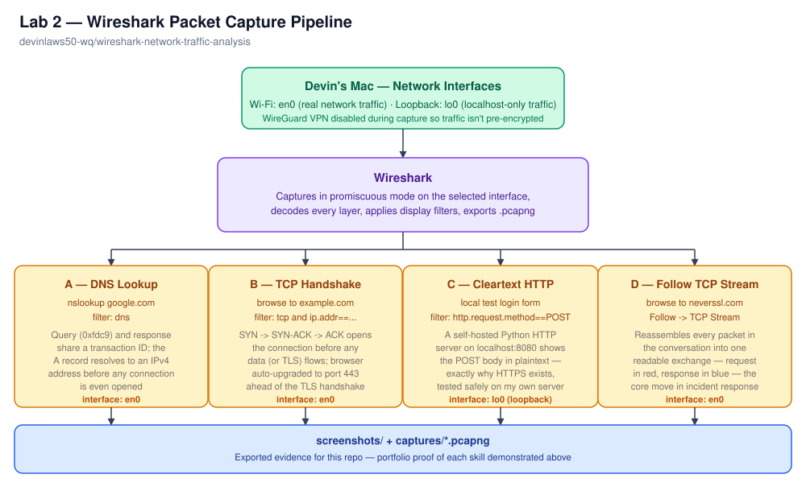
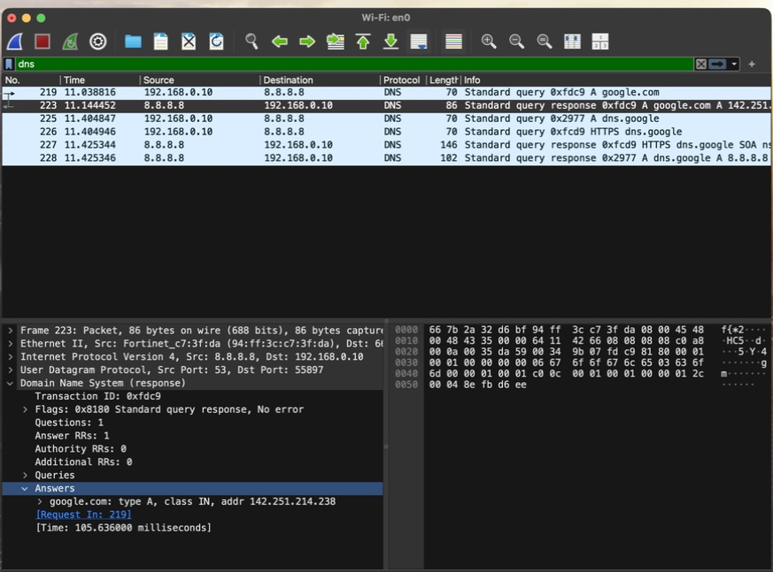
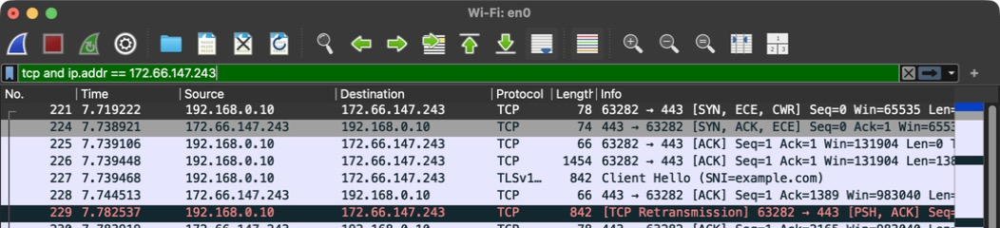
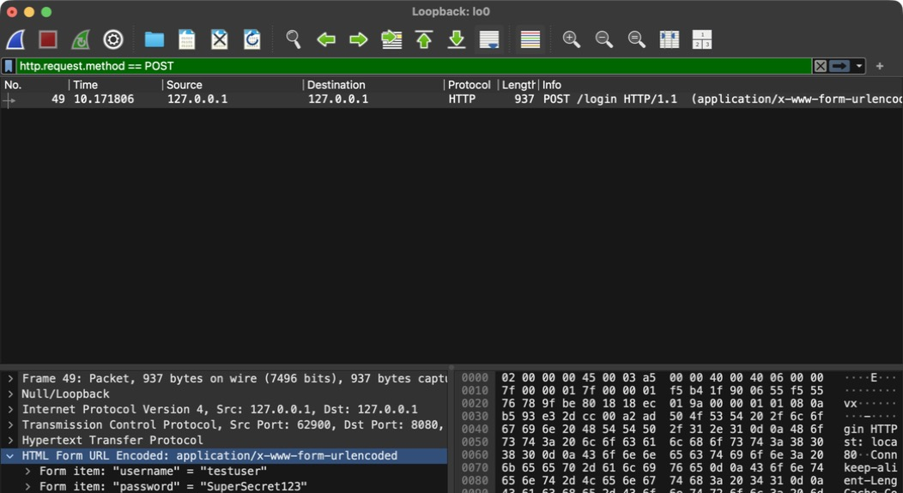
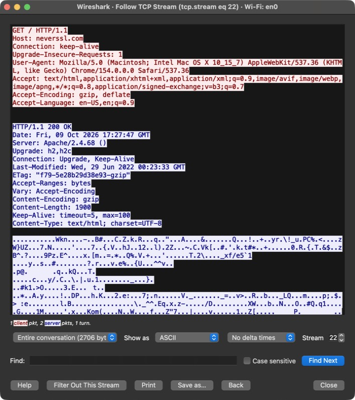

# Wireshark Network Traffic Analysis

Hands-on packet capture and analysis using Wireshark — captured, filtered, and interpreted real traffic on my own machine to demonstrate the core skills a network engineer, SOC analyst, or incident responder uses daily: reading DNS resolution, verifying TCP connection setup, proving why HTTPS matters, and reconstructing full conversations from individual packets.

| Field | Value |
|---|---|
| Tool | Wireshark 4.6.9 (free, open source) |
| Environment | macOS, local machine (no cloud VM required) |
| Time to complete | ~2 hours across one session |
| Cost | $0 |
| Certification alignment | CompTIA Network+, Security+, CySA+ |

## Architecture



Wireshark puts the selected network interface into promiscuous mode, decodes every packet that crosses it, and lets a display filter narrow that firehose down to the handful of packets that actually matter. Four exercises below each isolate a different layer of that traffic — DNS resolution, TCP connection setup, unencrypted HTTP, and full-conversation reconstruction — captured on two different interfaces (`en0` for real network traffic, `lo0` for a safe, self-hosted HTTP demo).

One early wrinkle worth noting: I run a WireGuard VPN by default, and the first capture attempt showed nothing but opaque `WireGuard Protocol` packets between my machine and the VPN endpoint — the VPN encrypts everything, including DNS queries, before it ever reaches the physical interface. I disabled the VPN for the rest of this lab so the underlying DNS/TCP/HTTP traffic was actually visible in plaintext.

## Exercise A — DNS Lookup

**Goal:** capture a DNS query and its matching response, and confirm they agree on the resolved IP address.

**Method:** started a capture on `Wi-Fi: en0`, ran `nslookup google.com` in Terminal, stopped the capture, and filtered on `dns`.



Packet 219 is the query — my machine asking `8.8.8.8` "what's the A record for google.com?" — and packet 223 is the response, resolving to `142.251.214.238`. Both carry the same DNS **transaction ID** (`0xfdc9`); that ID is how a resolver matches a response to its original question, since DNS runs over UDP and has no concept of a persistent connection to track that pairing. Expanding the response's **Answers** section shows the actual A record. This exact query/response pair happens, invisibly, before almost every network action a machine takes — which is also why unexpected DNS queries to unfamiliar domains are one of the first things a SOC analyst looks for when hunting malware beaconing to a C2 server.

Capture file: [`captures/dns-lookup-google-com.pcapng`](captures/dns-lookup-google-com.pcapng)

## Exercise B — TCP Three-Way Handshake

**Goal:** watch a TCP connection get established from nothing, and be able to explain what each packet means.

**Method:** fresh capture on `en0`, browsed to `http://example.com`, stopped the capture, resolved `example.com`'s IP with `nslookup`, and filtered on `tcp and (ip.addr == 172.66.147.243 or ip.addr == 104.20.23.154)` (example.com resolves to either of two CDN-fronted IPs).



| Packet | Flags | Meaning |
|---|---|---|
| 509 | `SYN` | My machine: "I want to connect, starting sequence number 0." |
| 513 | `SYN, ACK` | The server: "Received, here's my sequence number, connection accepted." |
| 514 | `ACK` | My machine: "Confirmed — connection open, ready to send data." |

Worth flagging: even though I typed `http://`, the destination port is **443**, not 80 — the browser silently upgraded to HTTPS on its own (standard behavior now via HSTS/default-HTTPS policies). That doesn't change what this exercise demonstrates: the three-way handshake happens identically regardless of what rides on top of it. Packet 516, right after the handshake completes, is the TLS **Client Hello** — proof that encryption negotiation only starts *after* the underlying TCP connection is already open. A SYN with no SYN-ACK in response is the single fastest signal of "the server is down, the port's closed, or a firewall is blocking me."

Capture file: [`captures/tcp-handshake-example-com.pcapng`](captures/tcp-handshake-example-com.pcapng)

## Exercise C — Cleartext Credentials Over HTTP

**Goal:** demonstrate, concretely and safely, why submitting a login form over plain HTTP exposes credentials to anyone who can see the traffic.

**Method:** rather than target a real third-party site (not legal or appropriate to test against infrastructure I don't own), I wrote a minimal local HTTP server — [`test-server/http_login_demo.py`](test-server/http_login_demo.py) — that serves a login form over plain HTTP on `localhost:8080`, pre-filled with obviously fake credentials. Captured on the **loopback interface (`lo0`)**, since localhost traffic never touches the Wi-Fi adapter, submitted the form, stopped the capture, and filtered on `http.request.method == POST`.



Packet 49 is the POST request, and expanding **HTML Form URL Encoded** shows the submitted fields in plain, readable text: `username = "testuser"`, `password = "SuperSecret123"`. No decryption, no special tooling — just reading the payload directly off the wire. This is the entire reason HTTPS became non-negotiable for any form handling sensitive data: without TLS, anyone positioned on the network path (an ISP, a coffee-shop router, an attacker doing a man-in-the-middle) can read credentials exactly as typed.

## Exercise D — Follow TCP Stream

**Goal:** reassemble an entire HTTP conversation from individual packets into one readable exchange.

**Method:** capture on `en0`, browsed to `http://neverssl.com` (a site intentionally built to stay on plain HTTP for testing like this), filtered on `http`, right-clicked a packet → **Follow → TCP Stream**.



Red text is my browser's request (`GET / HTTP/1.1`, headers, user agent); blue is the server's response (status line, headers, then the gzip-compressed page body — which is why that section renders as binary noise rather than HTML; it's compressed, not encrypted). Individual packets are fragments of a conversation; this view is the reconstructed whole. This is the core move an incident responder makes when reviewing a capture after something's gone wrong — reconstructing exactly what was requested, what was sent back, and in what order.

Capture file: [`captures/tcp-stream-neverssl.pcapng`](captures/tcp-stream-neverssl.pcapng)

## Repository Structure

```
wireshark-network-traffic-analysis/
├── README.md
├── diagrams/
│   └── architecture-diagram.svg
├── screenshots/
│   ├── 01-dns-query-response.png
│   ├── 02-tcp-handshake.png
│   ├── 03-http-cleartext-credentials.png
│   └── 04-tcp-stream-follow.png
├── captures/
│   ├── dns-lookup-google-com.pcapng
│   ├── tcp-handshake-example-com.pcapng
│   └── tcp-stream-neverssl.pcapng
└── test-server/
    └── http_login_demo.py
```

## Key Takeaways

Reading packets directly removes the guesswork from "is the network actually the problem?" A DNS query/response pair with mismatched transaction IDs, a SYN with no SYN-ACK, or a POST body nobody meant to leave the building — all of these are invisible from the application layer but immediately obvious in a capture. That's the mental model this lab builds, and it transfers directly to cloud-native equivalents like Azure Network Watcher or AWS VPC Flow Logs, which answer the same questions at a different altitude.

The VPN-masking discovery in the setup was also a useful reminder on its own: a capture tool can only see what actually reaches the interface it's listening on. If traffic is tunneled, encrypted, or routed somewhere else first, "I don't see it in Wireshark" doesn't mean it didn't happen — it means you're capturing at the wrong point in the path.
